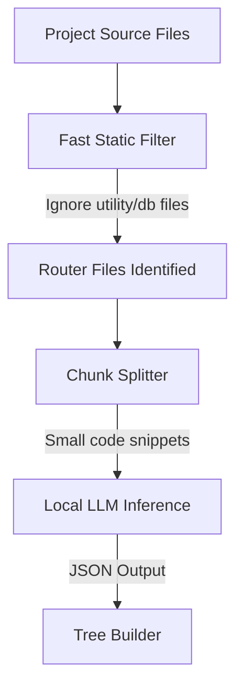

# RouteLens Local AI Scanner Design

This document proposes the architecture for integrating a **local, lightweight, and offline LLM** into RouteLens to handle diverse JavaScript/TypeScript backend frameworks (Tier 1 & Tier 2) without writing manual AST parsers for each one.

---

## 1. The Core Challenge: AST Scalability
Writing manual AST visitors (`expressParser.ts`) for every framework (Hono, NestJS, Fastify, Koa, Feathers) is highly robust but:
- Requires deep framework-specific expertise.
- Is time-consuming and fragile to framework version updates.
- Limits the tool to only hardcoded frameworks.

### The Solution: AI-Assisted Static Scanning
Instead of manually matching AST nodes, we can use a **local LLM** to analyze file contents. 
To ensure it is fast and doesn't overload the user's system, we must not pass whole codebases to the AI. Instead, we use a **hybrid parsing pipeline**:



---

## 2. Local LLM Execution Options

Here are the three primary options for running a local model inside an Electron app, ranked by feasibility:

### Option A: WebGPU Execution (Recommended)
Using libraries like **WebLLM** or **Transformers.js** (ONNX Runtime Web) to run model inference directly in the Electron process using the user's graphics card.
* **Model Choice**: `Llama-3.2-1B-Instruct` or `Qwen-2.5-0.5B-Instruct` (both under 1GB in size).
* **Pros**: 
  - Zero external installation required for the user.
  - Runs in a single click; weights are downloaded once and cached locally.
  - Native WebGPU speed is lightning fast on modern laptops.
* **Cons**: First-time scan requires downloading the model weights (approx. 700MB–1.5GB).

### Option B: Ollama Integration
Connecting to an **Ollama** instance running on the user's machine (`http://localhost:11434`).
* **Model Choice**: `phi3:mini` (3.8B), `qwen2:1.5b`, or `llama3.2` (3B).
* **Pros**: 
  - Highly optimized; handles CPU/GPU utilization automatically.
  - Offloads model memory management from the Electron app.
* **Cons**: Requires the user to download and install Ollama separately, adding setup friction.

### Option C: Llama.cpp Node Bindings (`node-llama-cpp`)
Embedding raw C++ bindings inside the Electron main process to load GGUF model files.
* **Pros**: Completely self-contained, no external apps, no browser WebGPU dependencies.
* **Cons**: Native Node bindings require platform-specific compilations, which makes cross-platform Electron bundling (Windows, Mac, Linux) fragile.

---

## 3. Implementation Workflow: AI Route Extraction

To keep scans under **2–5 seconds**, we process files in parallel chunks:

1. **Static Pre-filtering (Regex/AST)**:
   We scan files for keywords like `Router`, `@Controller`, `hono`, `fastify`, `app.get` to find routing files.
2. **Context Minimization**:
   We extract only the routing definitions (e.g. removing controller business logic, helper functions, and database queries) before sending it to the model.
3. **Structured Prompting**:
   We instruct the model to return raw JSON matching our schema:
   ```json
   [
     {
       "path": "/api/v1/users/:id",
       "method": "GET",
       "description": "Retrieve user details by ID"
     }
   ]
   ```
4. **Validation**:
   The output JSON is parsed and fed directly into `buildTreeFromRoutePaths`.

---

## 4. Immediate Roadmap (Action Plan)

1. **Verify WebGPU Support**: Test model initialization speed using `WebLLM` with the `Llama-3.2-1B` model.
2. **Develop the Pre-Filter**: Write a fast regex/keyword scanner to narrow down the file pool.
3. **Create the AI Parser Handler**: Implement a fallback parser (`aiFallbackParser.ts`) that runs when the project framework is unrecognized.
