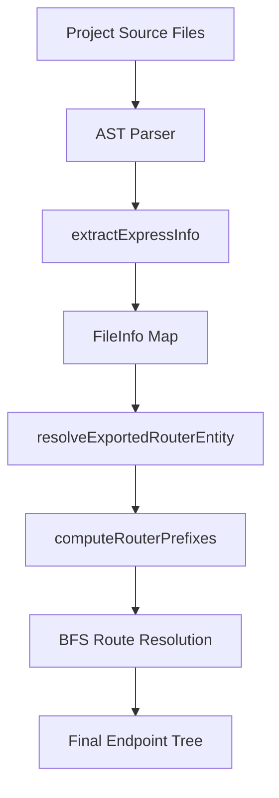

# RouteLens Scanner Architecture

This document details the AST-based Route Scanner architecture designed to scan Express backends, build routing hierarchies, and handle complex coding structures in production.

---

## 1. High-Level Scanner Architecture

The scanner runs in three main steps:
1. **AST Generation**: Source code is read and parsed into Abstract Syntax Trees (AST) using Babel.
2. **File Information Extraction**: Each file is statically traversed to collect declared routers, local endpoints, mounting paths (`.use`), and imports/exports metadata.
3. **Prefix Propagation (BFS)**: Starting from root `app` instances, the mounting graph is traversed to propagate route prefixes (e.g. `/api/v1/crm/opportunities`) to leaf routers.

---

## 2. Deep Dive: Key Core Components

### A. Import Resolver (`resolveImport.ts`)
The import resolver maps import source references (e.g., `'@/routes/crm'`) to physical file locations on the user's filesystem:
- **TSConfig Config Inheritance**: Automatically searches for the nearest `tsconfig.json`/`jsconfig.json` and recursively resolves paths when configured with `"extends": "./tsconfig.paths.json"`.
- **ESM Extension Stripping**: Strips `.js` or `.jsx` source suffixes (common in ESM environments) so the system can match physical `.ts` or `.tsx` files on disk.
- **BaseUrl Lookups**: Resolves absolute module lookups relative to the defined `"baseUrl"`.

### B. AST Information Extractor (`expressParser.ts`)
Traces each file using Babel visitors to build a metadata object:
* **Import & Require Mapping**: Tracks exactly how modules are imported (default imports, named imports, namespace namespace imports `import * as x`, destructured requires, and simple requires).
* **Router & App Declarations**: Detects variable assignments executing `express()` or `Router()`.
* **Endpoints Registration**: Scans HTTP method calls (e.g. `router.get()`, `router.patch()`) and extracts paths, JSDocs descriptions, and middleware variables.
* **Mount Declarations**: Captures `app.use('/prefix', target)` to record how routers connect.

### C. Barrel File & Re-export Resolver
To prevent "shelterless" routes when routers are exported/imported through index/barrel files:
* **Re-export Maps**: Registers all namespace re-exports (`export * from ...`) and explicit name re-exports (`export { default as crmRouter } from './crm'`).
* **Recursive Target Finder**: The `resolveExportedRouterEntity` function recursively resolves imports through any number of barrel files to find the actual file containing the router definition.

---

## 3. Production Resiliency Checklist

When users connect custom Node/Express backends, the scanner handles these developer styles:

| Pattern | Express Code Example | Scanner Resolution |
| :--- | :--- | :--- |
| **Namespace Imports** | `import * as crm from './crm'` | Parsed as `ImportNamespaceSpecifier` and registered in specifier maps. |
| **Named Router Exports** | `export const authRouter = Router()` | Parsed as `ExportNamedDeclaration` and mapped to its local variable. |
| **Re-exporting Barrel files** | `export { default as crm } from './crm'` | Parsed as named re-export; resolved recursively. |
| **CommonJS Require Mounts** | `app.use('/crm', require('./crm'))` | Resolves the inline require statement target. |
| **Destructured CommonJS** | `const { auth } = require('./auth')` | Parses object destructuring variables. |

---

## 4. Troubleshooting & UI Layer Fallbacks

For any cases that static analysis cannot parse (e.g. dynamic runtime loading), RouteLens provides:
1. **Unmounted Grouping**: Routers that are never mounted on an active `app` are rendered as root-level routes (e.g., `DELETE :opportunityId`) so they remain fully editable and testable.
2. **Dynamic UI Overrides**: The application allows users to drag-and-drop these unmounted routes into folders or manual prefix structures inside the UI, persisting configuration overrides locally in the workspace.
