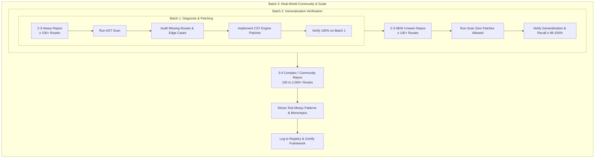

# OmniRoute Scanner Engine — Testing & Certification Protocol
**Universal 3-Batch & 3-Level Engine Validation Specification**

> **AI INSTRUCTION / QUICK START DIRECTIVE**:
> When a user instructs you: *"Follow `ENGINE_TESTING_PROTOCOL.md` to test [framework/language]"*, you must execute this protocol strictly and autonomously without asking redundant setup questions.
> **MANDATORY FIRST STEP**: Always read [`TESTED_REPOSITORIES_REGISTRY.md`](./TESTED_REPOSITORIES_REGISTRY.md) before cloning or running any tests. **NEVER** re-clone or re-test a repository that is already listed in the registry unless explicitly instructed by the user.

---

## 1. Core Testing Philosophy & Quality Standard

The OmniRoute scanner is engineered to discover 100% of API endpoints, HTTP verbs, route parameters, and request payload fields directly from raw, uninstalled source code across any language.

To ensure enterprise-grade reliability, all testing must adhere to four immutable rules:
1. **Zero Fake / Mock Testing**: Every test must run against real, public, production repositories or real user codebases. Never write trivial test mocks or mock ASTs.
2. **Substantial Scale ($\ge 100+$ to 2,000+ Routes)**: Do not test against 5-route "Hello World" starters. Repositories must represent real-world enterprise architectures with realistic route volumes.
3. **Pure Tree-sitter CST Enhancement**: When edge cases or missing routes are diagnosed, patch the engine using Concrete Syntax Tree (CST) queries and AST visitors in `src/main/lib/scanner/omniroute/`. **NEVER** use brittle regex shortcuts or hardcoded file-path heuristics.
4. **Strict Dual Metric**: Every tested framework must achieve $\ge 98\% - 100\%$ Recall (no missed routes) and $100\%$ Precision (zero false positives/duplicates).

---

## 2. The 3-Batch Evaluation Methodology

Testing for any framework or language must always be executed in three distinct, sequential batches:



### Batch 1: Heavy Diagnosis & Parser Patching
- **Target**: 2 to 3 real production repositories, each containing $\ge 100+$ routes.
- **Objective**: Identify parser edge cases, missing AST visitor patterns, unhandled decorator forms, dynamic route prefixes, or custom router factory wrappers.
- **Workflow**:
  1. Check [`TESTED_REPOSITORIES_REGISTRY.md`](./TESTED_REPOSITORIES_REGISTRY.md) for existing repos in this framework. Pick new ones.
  2. Shallow-clone the repositories (`git clone --depth 1 <url> scratch/repos/<name>`).
  3. Execute an initial AST scan using `scanOmniRoutes(targetDir, { mode: 'ast' })`.
  4. Compare detected routes against an exhaustive code audit (manual review of controller/router files).
  5. If any route is missed or mis-parsed, inspect the AST node structure and update the framework's CST visitor in `src/main/lib/scanner/omniroute/languages/`.
  6. Re-run until Batch 1 achieves **100.0% Recall and 100.0% Precision**.

### Batch 2: Post-Patch Generalization Verification
- **Target**: 2 to 3 **completely new, unseen** repositories with $\ge 100+$ routes each.
- **Objective**: Verify that the CST visitors patched in Batch 1 generalize cleanly out-of-the-box without regressions or framework-specific overfitting.
- **Constraint**: **Zero custom patches allowed** for Batch 2 repositories. The engine must discover the routes using its existing general-purpose grammar logic.
- **Pass Threshold**: $\ge 98\% - 100\%$ Recall and $100\%$ Precision. If a major regression occurs, step back to Batch 1 to adjust the visitor logic.

### Batch 3: Real-World Community & Enterprise Stress Test
- **Target**: 3 to 4 diverse, real-world community or user-written repositories.
- **Difficulty Curve**: Escalating scale from 100 routes up to **2,000+ routes**.
- **Architecture Diversity**:
  - Messy, non-standard router mountings (e.g., custom helper functions, inline loop registrations).
  - Deeply nested subrouters and multi-level prefix concatenation.
  - Mixed JavaScript and TypeScript in the same project.
  - Monorepos with multiple services or client/server co-located.
- **Objective**: Validate parser speed (sub-second to low-second latency), memory stability (no heap exhaustion), and zero crashes under chaotic, un-curated code structures.
- **Outcome**: Update the master certification matrix and append all repos to [`TESTED_REPOSITORIES_REGISTRY.md`](./TESTED_REPOSITORIES_REGISTRY.md).

---

## 3. The 3-Level Scanning Architecture

The engine operates on a layered analysis pipeline. When debugging or diagnosing route detection issues, determine which level failed:

| Level | Component | Responsibility | Failure Symptoms & Debug Steps |
| :--- | :--- | :--- | :--- |
| **Level 1** | **Universal Syntax Ingestion & Framework Signatures** | Uses Tree-sitter WASM to parse files into Concrete Syntax Trees (CST). Discovers route registration call-sites, HTTP decorators (`@Get`, `@Post`), and function handlers. | Route call-site not recognized $\to$ inspect AST with Tree-sitter playground; add AST visitor query. |
| **Level 2** | **Symbolic Abstract Interpretation & Path Linker** | Traces inter-file imports, resolves prefix mountings (`app.use('/api/v1', router)`), normalizes URL parameters (`:id`, `[id]`, `{id}`), and harvests request bodies/query params. | Route detected with missing prefix (e.g., `/users` instead of `/api/v1/users`) $\to$ fix prefix mount resolver in `symbolicLinker.ts` or language visitor. |
| **Level 3** | **Hybrid Safety Nets & Heuristic Intelligence** | Zero-latency fallback mechanisms: zero-config runtime probe (`app._router.stack`) for dynamic loop registrations, plus the native sub-millisecond heuristic humanizer for route naming. | Scan takes $>5\text{ s}$ $\to$ verify external AI calls are bypassed (`API_EXPLORER_AI_NAMING=false`) and native heuristic namer is used. |

---

## 4. Mandatory Registry Management Protocol

To prevent wasted tokens, repeated cloning, and redundant work across multiple conversations, the AI **must strictly maintain [`TESTED_REPOSITORIES_REGISTRY.md`](./TESTED_REPOSITORIES_REGISTRY.md)**.

### Step-by-Step AI Execution Rules:
1. **Deduplication Check (Mandatory)**:
   - Before downloading or testing any repository, open [`TESTED_REPOSITORIES_REGISTRY.md`](./TESTED_REPOSITORIES_REGISTRY.md).
   - Search for the repo name (`owner/repo`).
   - If the repo is already present, **DO NOT TEST IT AGAIN**. Inform the user it has already been tested and pick an alternative candidate repository.
2. **Cloning Protocol**:
   - Use shallow clone: `git clone --depth 1 <repo_url> scratch/repos/<owner>_<repo>`.
   - Never commit cloned test repositories into git (`scratch/repos/` is gitignored).
   - After testing is complete, clean up large repos if disk space is a constraint.
3. **Updating the Registry**:
   - Immediately upon concluding a test batch, update [`TESTED_REPOSITORIES_REGISTRY.md`](./TESTED_REPOSITORIES_REGISTRY.md).
   - Add entries in the markdown table with:
     - Repo Name (`owner/repo`) & GitHub Link
     - Language & Framework
     - Batch Number (1, 2, or 3)
     - Candidate Files Count
     - Discovered Routes Count
     - Recall % & Precision %
     - Latency (ms)
     - Architectural Notes & Date

---

## 5. Standard Test Harness Template

All tests should be run using a standalone TypeScript harness executed via `npx tsx scripts/<script-name>.ts`.

```typescript
import path from "node:path";
import { performance } from "node:perf_hooks";
import { scanOmniRoutes } from "../src/main/lib/scanner/omniroute";

interface TargetRepo {
  name: string;
  url: string;
  framework: string;
  batch: 1 | 2 | 3;
  expectedRoutesMin: number;
}

async function runBenchmark(repoPath: string, meta: TargetRepo) {
  console.log(`\n========================================`);
  console.log(`Testing: ${meta.name} [${meta.framework}] (Batch ${meta.batch})`);
  console.log(`Target: ${repoPath}`);
  console.log(`========================================`);

  const t0 = performance.now();
  const result = await scanOmniRoutes(repoPath, { mode: "ast" });
  const latencyMs = Math.round(performance.now() - t0);

  console.log(`Routes Discovered : ${result.routes.length}`);
  console.log(`Candidate Files   : ${result.candidateFilesCount}`);
  console.log(`Scan Latency      : ${latencyMs} ms`);

  // Sample top 5 routes
  console.log(`\nSample Routes:`);
  result.routes.slice(0, 5).forEach((r) => {
    console.log(`  [${r.method.padEnd(6)}] ${r.path} (${r.summary || "No summary"})`);
  });

  return {
    repo: meta.name,
    framework: meta.framework,
    batch: meta.batch,
    routes: result.routes.length,
    files: result.candidateFilesCount,
    latencyMs,
  };
}
```

---

## 6. Prompt Template for Future Conversations

When continuing testing in a new chat session, copy and paste this command:

```text
Please read ENGINE_TESTING_PROTOCOL.md and TESTED_REPOSITORIES_REGISTRY.md.
I want you to run the 3-batch testing protocol for [FRAMEWORK_OR_LANGUAGE].
Check the registry before testing to ensure you do not repeat any previously tested repository.
Follow the 3-batch sequence (Batch 1: Diagnosis & Patching, Batch 2: Generalization, Batch 3: Community/Large Scale), maintain ≥98-100% precision/recall, and record all new results into TESTED_REPOSITORIES_REGISTRY.md when finished.
```
