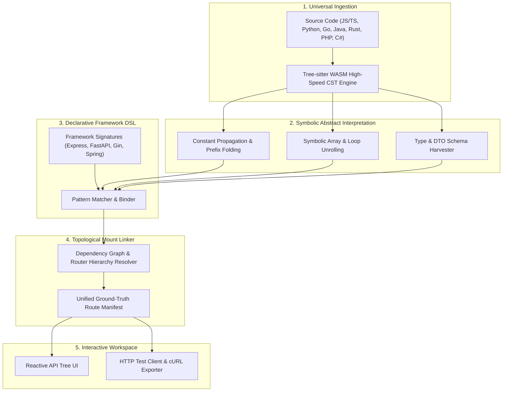

<div align="center">

# ⚡ RouteLens

### **Autonomous Zero-Config API Discovery Engine & Developer Command Center**

*Statically compile your backend source code into an interactive, drift-free API collection in milliseconds.*

[](https://github.com/Tilak46/RouteLens/releases)
[](https://github.com/Tilak46/RouteLens/actions)
[](https://github.com/Tilak46/RouteLens/releases)
[](https://www.typescriptlang.org/)
[](https://www.electronjs.org/)
[](LICENSE)

<br/>

[**Explore Features**](#-key-features) •
[**How It Works**](#-how-it-works-the-omniroute-engine) •
[**Supported Frameworks**](#-supported-frameworks--languages) •
[**System Architecture**](#-system-architecture) •
[**Download & Installation**](#-download--installation) •
[**Roadmap**](#-roadmap)

<br/>

</div>

---

## 💡 Why RouteLens? (The Problem)

Every backend engineer and engineering team suffers from **API Collection Drift**:

1. **The Postman & Insomnia Tax**: Developers spend countless hours manually copying endpoint paths, query parameters, path variables, and payload headers from backend code into Postman. The moment a route is refactored, renamed, or deleted, collections become outdated and broken.
2. **The Swagger / OpenAPI Decorator Fatigue**: Keeping OpenAPI specifications synchronized requires polluting clean business logic with hundreds of boilerplate decorators (`@ApiOperation`, `@ApiResponse`, `@ApiParam`). In fast-paced sprints, documentation is the first thing that rots.
3. **Heavy Enterprise Bloat & Cloud Privacy Risks**: Modern API tools have devolved into bloated cloud platforms with mandatory accounts, slow load times, and security risks associated with syncing proprietary internal API schemas to third-party clouds.

### The Solution: RouteLens

**RouteLens** treats your backend source code as the single source of truth. By combining **Tree-sitter WebAssembly Concrete Syntax Trees (CST)** with an **Abstract Interpretation Mount Linker**, RouteLens statically analyzes raw, uncompiled source code across your project directories, automatically discovering:
* **Declared HTTP endpoints** (`GET`, `POST`, `PUT`, `PATCH`, `DELETE`, etc.)
* **Dynamic URL parameters & path variables** (`/api/v1/users/:id/orders/:orderId`)
* **Nested router hierarchies & factory-instantiated routers**
* **Request payloads, query parameters, and header expectations**

**Zero Docker containers. Zero running servers. Zero cloud sync. Completely offline and local.**

---

## 🚀 Key Features

### 🔍 Autonomous Zero-Config Route Discovery
Point RouteLens to any project folder or monorepo workspace. Within **150ms**, RouteLens parses your entire source tree and constructs a living, interactive API hierarchy. No configuration files, no server execution, and no runtime dependencies needed.

### 🌐 Universal Multi-Language & Polyglot Engine
Built on WebAssembly-compiled Tree-sitter parsers, RouteLens understands routing idioms across **JavaScript, TypeScript, Python, Go, Java, Rust, PHP, and C#**. Whether you use Express routers, NestJS controller decorators, FastAPI path operations, Gin engine groups, or Spring Boot `@RequestMapping`, RouteLens discovers them all.

### 🧩 Topological Mount & Router Disambiguation
Unlike naive regex tools that miss multi-file router mounts, RouteLens resolves complex, production-grade architectural patterns:
* **Nested Router Trees**: Traces `app.use('/api', v1Router)` -> `v1Router.use('/users', userRouter)` -> `userRouter.get('/:id')` to emit `/api/v1/users/:id`.
* **Factory Function Routers**: Detects custom router generators (`const router = makeCrudRouter(Model)`).
* **Multi-Router Module Re-exports**: Accurately tracks variables across commonjs `module.exports` and ECMAScript `export default`.

### ⚡ Interactive In-App API Client
Test discovered endpoints immediately without opening a second tool:
* **One-Click Execution**: Send HTTP requests with configurable environments, headers, and body payloads.
* **Smart URL Variable Interpolation**: Automatically recognizes path tokens (`:id`, `{userId}`) and renders dedicated variable input fields.
* **Instant cURL Generation**: Copy production-ready cURL commands directly from any discovered endpoint.
* **Response Inspector**: High-speed JSON formatting, status indicators, response timing, and header inspection.

### 🖥️ Local Developer Command Center
RouteLens is more than an API client—it's an operational dashboard for your local engineering workflow:
* **Integrated Process Runner**: Start, monitor, and restart your backend servers and database containers directly within the app.
* **Streaming Terminal Viewer**: Clean log viewer with ANSI color parsing and keyword search.
* **Git Status & Commit Generator**: Live branch tracking and AI-assisted commit message generation.

---

## 🧠 How It Works: The OmniRoute Engine

Traditional static scanners fail on real-world production codebases because they rely on brittle AST visitor scripts that break the moment developers use helper wrappers, loops, or factory functions.

RouteLens operates via a **5-Layer Code Intelligence Architecture**:



### Engineering Highlights:
1. **Tree-sitter WebAssembly Core**: High-throughput Concrete Syntax Tree parsing running at **1–3ms per file** with an ultra-compact memory footprint (~5 MB per grammar). Tree-sitter is naturally fault-tolerant, never throwing fatal errors on partial code or invalid syntax.
2. **Symbolic Constant Propagation**: Mathematically folds string concatenation trees across scopes (`const API = '/api'; const V1 = API + '/v1'; router.get(V1 + '/items')`) without executing arbitrary JavaScript.
3. **Array & Loop Unrolling**: Symbolically evaluates programmatic route registration arrays (`['get', 'post'].forEach(method => app[method](...))`).

For deep technical details, read the [OmniRoute Architecture Specification](docs/architecture/OMNIROUTE_ENGINE.md).

---

## 📊 Supported Frameworks & Ecosystem Coverage

RouteLens is actively tested against real-world open-source repositories to validate AST precision and mount resolution:

| Ecosystem | Frameworks / Libraries | Status | Routing Patterns Supported |
| :--- | :--- | :---: | :--- |
| **Node.js / TypeScript** | Express, NestJS, Fastify, Hono, Next.js (App & Pages) | 🟢 **Stable** | Sub-routers, controller decorators, chained handlers, prefix mounts |
| **Python** | FastAPI, Flask, Django REST Framework | 🟢 **Stable** | APIRouter, Blueprint prefixes, path decorators, ViewSets |
| **Go** | Gin, Fiber, Echo, Chi, standard `net/http` | 🟡 **Active** | Engine groups, sub-routing, method handlers |
| **Java / Kotlin** | Spring Boot (`@RestController`, `@RequestMapping`) | 🟡 **Active** | Class & method annotations, path variables |
| **Rust** | Actix-web, Axum | ⚪ **Beta** | Macro-based route declarations, scoped services |
| **PHP** | Laravel Routes (`Route::get`), Symfony | ⚪ **Beta** | Static facade routing, controller groups |
| **C# / .NET** | ASP.NET Core Minimal APIs & Controllers | ⚪ **Beta** | `app.MapGet` patterns, route attributes |

> [!NOTE]
> **Engineering Philosophy & Precision**: Static analysis works best with conventional, idiomatic routing structures. To avoid cluttering your workspace with false positives, RouteLens strictly resolves verifiable AST evidence chains rather than making speculative guesses. Dynamic routes loaded via external database tables or custom runtime loaders are flagged for manual review.

See our [Benchmark Testing Protocol](docs/benchmarks/TESTING_PROTOCOL.md) and [Tested Repositories Registry](docs/benchmarks/REPOSITORIES_REGISTRY.md) for architectural test suites.

---

## 💻 System Architecture & Tech Stack

RouteLens is engineered with clean separation of concerns and native desktop performance:

* **Desktop Runtime**: [Electron 34](https://www.electronjs.org/) (Multi-process architecture: Main Process, Preload Sandbox, Renderer UI, Background Scanner Worker).
* **Language & Parsing Engine**: [TypeScript 5.8](https://www.typescriptlang.org/), [web-tree-sitter](https://github.com/tree-sitter/tree-sitter/tree/master/lib/binding_web), [@babel/parser](https://babeljs.io/), [@babel/traverse](https://babeljs.io/).
* **UI & Client Layer**: [React 19](https://react.dev/), [Vite](https://vitejs.dev/), [Tailwind CSS 4](https://tailwindcss.com/), [Radix UI](https://www.radix-ui.com/), [Lucide Icons](https://lucide.dev/), [Framer Motion](https://www.framer.com/motion/).
* **Code Editor**: [@uiw/react-codemirror](https://uiwjs.github.io/react-codemirror/) with JSON and JavaScript syntax highlighting.
* **Packaging & CI/CD**: [electron-builder](https://www.electron.build/), GitHub Actions multi-platform automated matrix (`macos-latest`, `ubuntu-latest`, `windows-latest`).

---

## 📥 Download & Installation

Pre-built binaries are automatically compiled and published for every release:

### 🍎 macOS
* **Apple Silicon (M1, M2, M3, M4)**: Download `RouteLens-Mac-*-arm64.dmg` from [Releases](https://github.com/Tilak46/RouteLens/releases).
* **Intel Macs**: Download `RouteLens-Mac-*-x64.dmg`.
* *Tip for macOS users*: If Gatekeeper prompts about an unidentified developer, right-click `RouteLens.app` -> **Open**, or run:
  ```bash
  xattr -cr /Applications/RouteLens.app
  ```

### 🪟 Windows
* Download `RouteLens-Windows-*-Setup.exe` from [Releases](https://github.com/Tilak46/RouteLens/releases) and run the installer.

### 🐧 Linux
* Download `RouteLens-Linux-*.AppImage` from [Releases](https://github.com/Tilak46/RouteLens/releases).
  ```bash
  chmod +x RouteLens-Linux-*.AppImage
  ./RouteLens-Linux-*.AppImage
  ```

---

## 🛠️ Local Development Setup

To build and run RouteLens locally from source:

### Prerequisites
* [Node.js](https://nodejs.org/) v20.x or v22.x LTS
* [npm](https://www.npmjs.com/) v10.x+
* Git

### Step-by-Step

1. **Clone the repository**:
   ```bash
   git clone https://github.com/Tilak46/RouteLens.git
   cd RouteLens
   ```

2. **Install dependencies**:
   ```bash
   npm install
   ```

3. **Start the development application** (with Hot Module Replacement):
   ```bash
   npm run dev
   ```

4. **Build distribution binaries locally**:
   ```bash
   # Build for Windows (on Windows host)
   npm run build:win

   # Build for Linux AppImage (via WSL on Windows, or natively on Linux)
   npm run build:linux
   ```

---

## 🗺️ Roadmap

- [x] **v1.0 Core**: High-speed AST scanning, topological router linking, and interactive HTTP explorer for Node.js backends.
- [x] **v1.1 Cross-Platform Multi-OS**: Automated CI/CD release matrix for Apple Silicon (`arm64`), Intel Mac (`x64`), Windows (`nsis`), and Linux (`AppImage`).
- [ ] **v1.2 Schema Inference**: Automatic extraction of request body DTOs and Zod/Pydantic validation schemas directly into pre-filled JSON payloads.
- [ ] **v1.3 Open Standard Export**: One-click bidirectional export and import to **OpenAPI 3.1**, **Postman Collection v2.1**, and **Bruno (`.bru`)**.
- [ ] **v1.4 Mock Server Engine**: Instant local mock API server generated dynamically from your extracted source code route tree.

---

## 📄 License

RouteLens is open-source software licensed under the **[MIT License](LICENSE)**.

---

<div align="center">

**Built with passion by [Tilak Patel](https://github.com/Tilak46)**

*Architected for developer happiness and seamless API exploration.*

</div>
